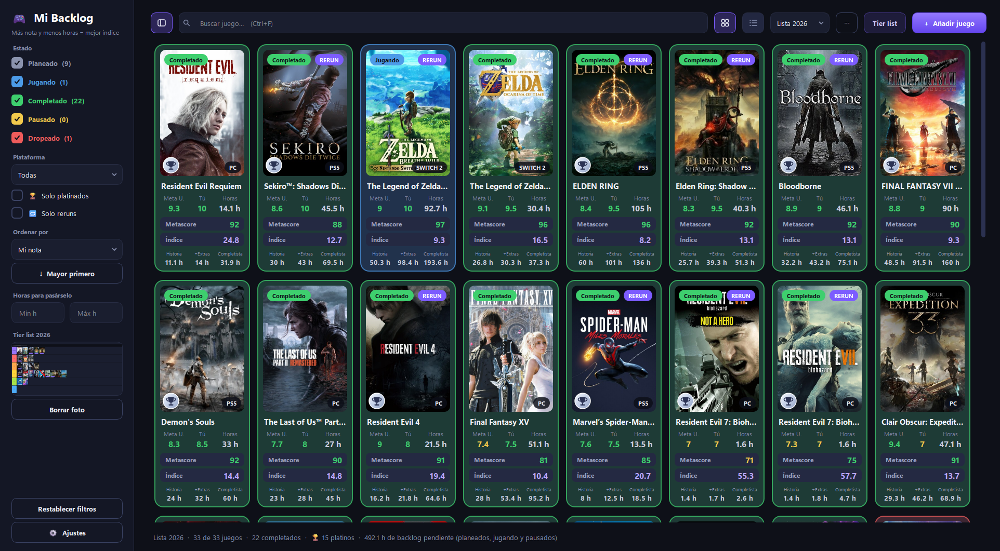
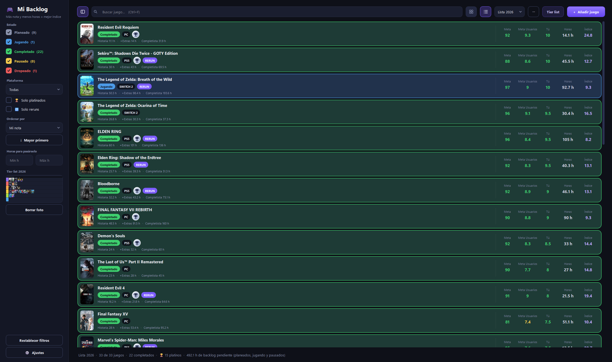
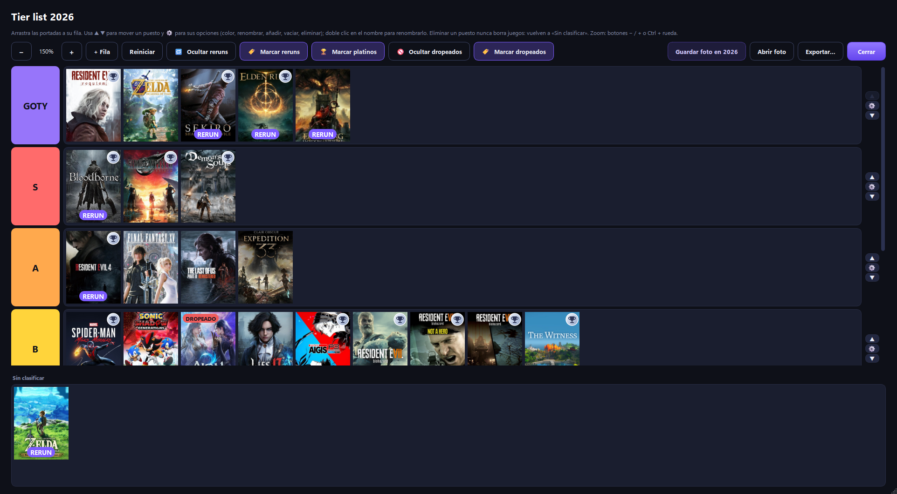
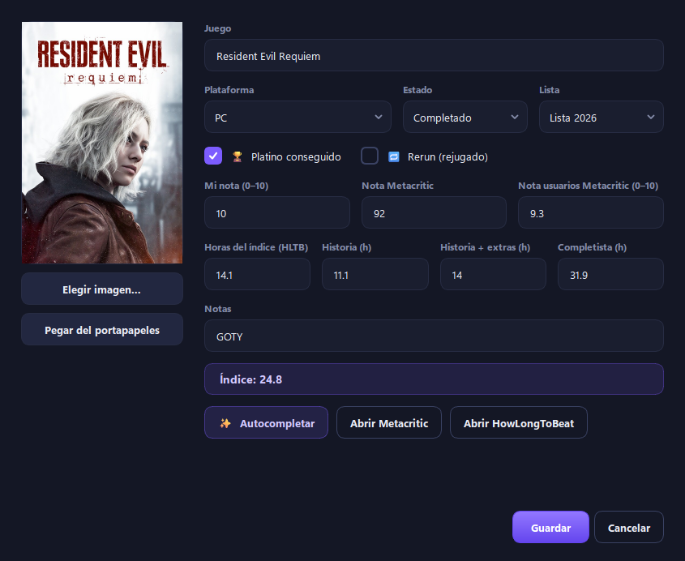

<h1 align="center">🎮 Mi Backlog de Juegos</h1>

<p align="center">
  App de escritorio (Python + PyQt6) para gestionar tu colección y backlog de videojuegos,<br>
  con notas y horas de juego rellenadas automáticamente desde Steam, HowLongToBeat y Metacritic.
</p>

<p align="center">
  <a href="docs/screenshots/main-cards.png"></a>
</p>

<table>
  <tr>
    <td width="34%" align="center" valign="top">
      <a href="docs/screenshots/main-list.png"></a><br>
      <sub><b>Vista de lista</b> con miniaturas y detalles</sub>
    </td>
    <td width="33%" align="center" valign="top">
      <a href="docs/screenshots/tierlist.png"></a><br>
      <sub><b>Tier list</b> de cada año</sub>
    </td>
    <td width="33%" align="center" valign="top">
      <a href="docs/screenshots/game-dialog.png"></a><br>
      <sub><b>Añadir / editar</b> con autocompletado</sub>
    </td>
  </tr>
</table>

<p align="center"><sub>Haz clic en una imagen para verla en grande. La app está en español.</sub></p>

## Qué hace

- **Carátula** automática, o elegida, pegada del portapapeles o soltada sobre el diálogo (un archivo o una imagen arrastrada desde el navegador).
- **Sugerencias de nombres** mientras escribes, por si te equivocas.
- **Plataforma** (PC, PlayStation, Switch / Switch 2, Nintendo DS / 3DS, Xbox, Emulador…), platino y etiqueta **Rerun** para los juegos que estás rejugando.
- **Nota de Metacritic de la plataforma elegida.** Si Metacritic no tiene nota para ella, usa la de otra plataforma **y te avisa** con un ⚠ en la ventana de edición. Siempre puedes elegir cualquier plataforma o escribir la nota a mano.
- **Horas de HowLongToBeat** (historia, historia + extras, completista) y **nota de usuarios de Metacritic**, rellenadas mientras escribes el nombre.
- Tu nota y un **índice** = nota de usuarios de Metacritic × 10 / √horas (más nota y menos horas = mejor índice), útil para decidir a qué jugar.
- **Estados con color** (Planeado, Jugando, Completado, Pausado, Dropeado).
- **Filtros y orden** por estado (con cuántos juegos hay en cada uno), plataforma, platino, reruns, notas (incluida la nota de usuarios de Metacritic), horas mínimas/máximas e índice. Se recuerdan entre sesiones. El buscador también mira en tus notas y en la plataforma.
- **Acciones rápidas:** con clic derecho sobre un juego cambias su estado, marcas platino o rerun, lo mueves a la lista de otro año o lo abres en Metacritic / HowLongToBeat. Con la lista seleccionada: `Enter` / `F2` edita, `1`–`5` cambian el estado y `Supr` lo elimina.
- **Seleccionar varios juegos** con `Ctrl` + clic (de uno en uno), `Mayús` + clic (un rango) o `Ctrl+A` (todos); `Esc` quita la selección. Después, con clic derecho les cambias el estado a todos, los mueves o copias a otra lista, o los eliminas; `1`–`5` y `Supr` también funcionan con toda la selección.
- **Deshacer:** al eliminar un juego aparece una barra con *Deshacer* durante unos segundos (o pulsa `Ctrl+Z`).
- **Aviso de repetidos** si añades un juego que ya está en la lista de ese año.
- **Una lista por año** (los juegos se pueden mover de año desde el diálogo o el clic derecho; crear o borrar listas en el menú `⋯`). Al acabar el año, `⋯` → *Mover o copiar juegos a otra lista* pasa de golpe todos tus Planeados (o los estados que elijas) a la lista del año siguiente: **moverlos**, o **copiarlos** para que se queden también en la de este año. Los completados se quedan donde están, y se puede deshacer.
- **Tier list** con portadas para cada lista (los Planeados no entran). Los puestos se pueden mover, cambiar de color, renombrar, añadir y eliminar; los reruns y los dropeados se pueden ocultar o marcar con una etiqueta, los platinos se pueden marcar, y el tier list se guarda como foto.
- **Vista de tarjetas y de lista**, menú lateral redimensionable y ocultable con el tier list del año.
- **Copia de seguridad:** exportar / importar todo en un `.zip` (la tuya o la de un amigo).
- **Copias automáticas diarias** de tu lista de juegos (las 10 últimas). Si `games.json` se daña, la app guarda el archivo dañado, carga la copia buena más reciente y te avisa.
- **Temas:** Oscuro (por defecto), Negro puro y Claro, en el menú ⚙ Ajustes.
- **Si una web cambia y la app deja de recibir notas u horas**, usa ⚙ Ajustes → *Actualizar la conexión con HowLongToBeat*, que instala la versión más nueva de la librería que lee HowLongToBeat (versión de Python; el `.exe` la recibe con cada actualización de la app). Los arreglos de Metacritic llegan con las actualizaciones de la app.
- **Se actualiza sola:** al abrirse comprueba en silencio (solo avisa si hay una versión más nueva), y ⚙ Ajustes → *Buscar actualizaciones* mira la última [Release](../../releases) de este repositorio. Si hay una versión más nueva enseña las novedades y, si aceptas, la descarga, comprueba que ha llegado completa, cierra la app y abre la versión nueva. Tus juegos no se tocan. Funciona con el `.exe` portable y con la versión de Python.

## Cómo usarla

Necesitas Python 3.9 o superior.

```
pip install -r requirements.txt
python mi_backlog_juegos.pyw
```

Tus datos se guardan en `~/.mi_backlog_juegos/` (en Windows: `C:\Users\<tu usuario>\.mi_backlog_juegos\`), fuera de esta carpeta. Las copias automáticas diarias están en su subcarpeta `backups/auto/`.

## Crear el .exe de Windows

```
python -m pip install -r requirements.txt pyinstaller
python -m PyInstaller --noconfirm --clean --onefile --windowed --name "Mi Backlog de Juegos" --icon mi_backlog_juegos.ico --collect-all howlongtobeatpy mi_backlog_juegos.pyw
```

El resultado es `dist\Mi Backlog de Juegos.exe`, un único archivo portable para Windows 10/11 de 64 bits. Si no arranca, instala el Microsoft Visual C++ Redistributable 2015-2022 (x64). Windows SmartScreen puede avisar porque el `.exe` no está firmado. Para un arranque más rápido, compila una carpeta: cambia `--onefile` por `--onedir` y comparte la carpeta entera (una carpeta no puede actualizarse sola; el `.exe` único sí).

## Privacidad

- No hay cuentas, claves ni telemetría. Lo único que sale a internet es el nombre del juego que escribes, hacia Steam, HowLongToBeat y Metacritic (por HTTPS), y la consulta de actualizaciones a las Releases de este repositorio.
- El resto se queda en tu ordenador, en archivos JSON de texto plano e imágenes.

## Aviso sobre Metacritic y HowLongToBeat

Ni Metacritic ni HowLongToBeat ofrecen una API pública y gratuita, así que la app lee los datos de sus páginas web públicas (Metacritic) y con la librería no oficial [`howlongtobeatpy`](https://pypi.org/project/howlongtobeatpy/) (HowLongToBeat). Es un proyecto personal y de uso pequeño:

- **Solo lee datos** (nota y horas de un juego). No publica, no inicia sesión y no modifica nada.
- **Hace pocas peticiones**: una por juego, y solo cuando tú escribes o pides el autocompletado. No recorre las webs ni guarda ni redistribuye sus datos; todo se queda en tu ordenador.
- Aun así, las condiciones de uso de esos sitios pueden no permitir el acceso automatizado. Si lo usas, hazlo de forma personal y con pocas consultas. Si alguno de esos sitios lo pide, esa parte se quitará.
- Como no son APIs oficiales, pueden dejar de funcionar si esas webs cambian. En ese caso siempre puedes escribir la nota y las horas a mano.

Este proyecto no está afiliado a Steam, HowLongToBeat ni Metacritic.

## Cómo se hizo

Diseñé y dirigí este proyecto: decidí qué hace la app, cómo se ve y cómo se comporta, y probé y revisé el resultado en cada paso. Gran parte del código lo escribieron agentes de IA a partir de mis instrucciones (prompts) sobre las funciones y la interfaz visual.

## Créditos

Esta app solo funciona gracias a estos servicios y librerías. Si reutilizas o modificas el proyecto, mantén estos créditos:

- **[Steam](https://store.steampowered.com/)** (Valve): carátulas, datos del juego y la nota de Metacritic de PC desde su tienda pública.
- **[HowLongToBeat](https://howlongtobeat.com/)**: horas de juego, con la librería [`howlongtobeatpy`](https://pypi.org/project/howlongtobeatpy/).
- **[Metacritic](https://www.metacritic.com/)**: notas por plataforma y nota de usuarios, leídas de sus páginas públicas.
- **[PyQt6](https://www.riverbankcomputing.com/software/pyqt/)** (Riverbank Computing): la interfaz.

Todos los nombres, notas, tiempos e imágenes pertenecen a sus dueños.

## Licencia

MIT © 2026 Dreex. Consulta [LICENSE](LICENSE): puedes usar y modificar el código siempre que mantengas el aviso de copyright y el texto de la licencia.

La app depende de PyQt6, que está bajo licencia GPLv3 (o una licencia comercial). Si distribuyes una versión que incluya PyQt6, como el `.exe`, esa versión también debe cumplir la GPLv3, que exige tener el código fuente disponible (este repositorio lo está). Esto no es asesoramiento legal.
